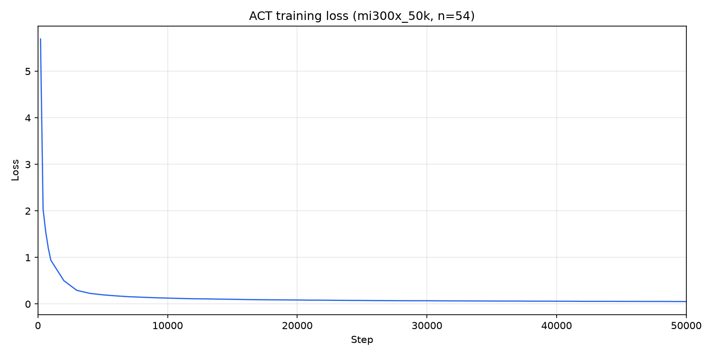

# SO-101

**SO-101 Robotic Imitation Learning: ACT, Diffusion Policy & SmolVLA**

基于 [LeRobot](https://github.com/huggingface/lerobot) 与 [MuJoCo](https://mujoco.org/) 构建的 SO-101 机器人模仿学习实验平台，覆盖专家示范采集、LeRobotDataset 数据处理、策略训练、仿真闭环评测及真实机器人操作。

## 当前任务概览

本项目包含两个任务设置不同的实验场景，请勿将它们混为同一个评测任务。

| 实验场景 | 当前任务 | 策略 |
|---|---|---|
| **MuJoCo 仿真** | **抓取红色方块，放入蓝色盒子** | ACT / Diffusion Policy / SmolVLA |
| **真实机器人** | 根据任务条件，从多个玩具中选择目标并完成抓取放置 | ACT / SmolVLA |

仿真任务的英文指令：

```text
Pick up the red cube and place it in the blue box.
```

> **实验结果口径**
>
> - 现有蓝色方块任务的历史仿真结果不代表新红色方块 / 蓝色盒子任务的成绩。
> - 旧 Checkpoint 不会因为场景颜色或任务文字修改而自动适配新任务。新任务需要使用对应示范数据重新训练或微调，并进行独立闭环评测。
> - 本 README 展示的 Rovo Labs 成功 / 失败视频来自外部 Hugging Face 数据集，不是本项目训练模型的独立评测录像，也不能据此计算本项目成功率。

---

## 目录

- [1. 项目介绍](#overview)
- [2. 系统架构](#architecture)
- [3. 项目演示](#demo)
- [4. 安装与快速开始](#installation)
- [5. 项目结构](#project-structure)
- [6. SO-101 MuJoCo 仿真环境](#simulation-environment)
- [7. 仿真专家示范与数据采集](#simulation-data)
- [8. LeRobotDataset 与外部数据](#dataset)
- [9. 仿真策略训练](#simulation-training)
- [10. MuJoCo 闭环评测与结果](#simulation-evaluation)
- [11. SO-101 真机实验环境](#real-environment)
- [12. 真机策略训练与部署](#real-deployment)
- [13. 真机实验设计与结果](#real-evaluation)
- [14. Hugging Face 数据管理](#huggingface)
- [15. 实验复现与注意事项](#reproducibility)
- [16. 致谢](#acknowledgements)
- [17. 许可证](#license)

---

<a id="overview"></a>

## 1. 项目介绍

本项目面向低成本机器人操作任务，构建基于视觉观测、机器人状态及任务条件的模仿学习系统。项目使用 SO-101 机械臂，在 MuJoCo 仿真环境与真实机器人环境中研究抓取放置、多物体干扰、目标条件操作及策略泛化能力。

### 1.1 MuJoCo 仿真任务

当前仿真任务为：

**抓取红色方块，放入蓝色盒子。**

场景中同时放置多个不同颜色的方块。红色方块是目标，蓝色、黄色和绿色方块是干扰物。机器人必须抓取正确的红色方块，并将其完整放入蓝色盒子。

使用以下三种模仿学习策略进行训练与闭环评测：

- **ACT**：Action Chunking with Transformers。
- **Diffusion Policy**：基于条件扩散的动作序列生成。
- **SmolVLA**：Vision-Language-Action 模型。

主要研究问题：

- 不同策略在相同红方块抓取与蓝盒放置任务中的表现。
- 多物体干扰下的目标选择、抓取与放置能力。
- 红色方块初始位置变化下的位置泛化能力。
- 策略启动、抓取、搬运和放置阶段的失败类型。

### 1.2 真实机器人任务

真实环境使用 SO-101 机械臂。桌面同时摆放多个不同玩具，每个 Episode 根据任务条件指定一个目标玩具，其余玩具作为干扰物。

例如：

```text
Episode 1:
Pick up the yellow duck and place it into the box.

Episode 2:
Pick up the red toy car and place it into the box.

Episode 3:
Pick up the teddy bear and place it into the box.
```

真机实验比较 ACT 与 SmolVLA：

- **ACT**：接收视觉观测、机器人状态及结构化目标类别信息。
- **SmolVLA**：接收视觉观测、机器人状态及自然语言任务指令。

真机实验沿用其多玩具目标抓取设置；不要将仿真任务的“红色方块 / 蓝色盒子”描述套用到真机实验，除非实际硬件场景也采用该设置。

### 1.3 对比模型

| 模型 | 核心方法 | 训练方式 | 实验环境 |
|---|---|---|---|
| ACT | Transformer + Action Chunking | 监督模仿学习 | 仿真 + 真机 |
| Diffusion Policy | Diffusion-based Action Generation | 扩散式模仿学习 | 仿真 |
| SmolVLA | Vision-Language-Action | 预训练模型微调 | 仿真 + 真机 |

ACT 与 Diffusion Policy 主要学习从机器人观测到动作序列的映射。SmolVLA 在视觉和机器人状态基础上引入语言条件，利用预训练视觉语言表示与动作生成模块学习机器人操作策略。

真机多目标实验中的 ACT 使用额外的目标条件编码，但仍归类为 ACT，不单独作为第四种模型。

### 1.4 研究范围

本项目当前重点关注：

1. **Simulation Policy Benchmark**：ACT、Diffusion Policy 和 SmolVLA 在统一 MuJoCo 任务下的闭环表现。
2. **Position Generalization**：红色方块出现在训练数据未覆盖的位置时，策略能否完成抓取放置。
3. **Multi-Object Manipulation**：真实环境中存在多个候选玩具时，模型能否根据任务条件选择正确目标。
4. **Task-Conditioned Manipulation**：ACT 的结构化目标类别条件与 SmolVLA 的自然语言条件如何支持真机目标选择。

目标切换、语言表达变化和新物体类别泛化属于可扩展研究方向；除非有对应测试记录，不应将它们写成已经完成的独立实验。

---

<a id="architecture"></a>

## 2. 系统架构

项目包含仿真模仿学习系统和真实机器人操作系统。两部分使用相同的 SO-101 机器人类型，但采用不同的任务设置与数据采集流程。

### 2.1 MuJoCo 仿真系统

```text
                  SO-101 MuJoCo
                        │
                        ▼
              Multi-Object Scene
                        │
                        ▼
          Red Cube → Blue Box Pick-and-Place
                        │
                        ▼
                Expert Controller
                  Mink IK + FSM
                        │
                        ▼
              Expert Demonstrations
                        │
                        ▼
                 LeRobotDataset
                        │
              ┌─────────┼─────────┐
              │         │         │
              ▼         ▼         ▼
             ACT       DP       SmolVLA
              │         │         │
              └─────────┼─────────┘
                        │
                        ▼
               Closed-loop Rollout
                        │
                        ▼
              Simulation Benchmark
```

系统使用 Mink IK 与有限状态机生成专家轨迹，将视觉、机器人状态和动作保存为 LeRobotDataset。训练后的策略在 MuJoCo 环境中独立执行闭环 Rollout。

### 2.2 真实机器人系统

```text
                   SO-101 Real Robot
                          │
                          ▼
                    Multiple Toys
                          │
                          ▼
                  Task Specification
                          │
              ┌───────────┴───────────┐
              │                       │
              ▼                       ▼
        Target Category       Language Instruction
              │                       │
              ▼                       ▼
             ACT                   SmolVLA
              │                       │
              └───────────┬───────────┘
                          │
                          ▼
                   Action Prediction
                          │
                          ▼
                   SO-101 Controller
                          │
                          ▼
                  Target Pick-and-Place
                          │
                          ▼
                  Real-world Evaluation
```

真机实验通过目标类别或自然语言指令指定当前操作对象。两种策略最终输出机器人动作，经安全检查后发送至 SO-101 控制接口。

### 2.3 核心功能模块

| 模块 | 功能 |
|---|---|
| MuJoCo Environment | SO-101 机器人与物理场景仿真 |
| Expert Controller | 基于 Mink IK 与 FSM 生成专家示范 |
| Data Collection | 采集图像、机器人状态、动作及任务信息 |
| LeRobotDataset | 统一存储机器人操作数据 |
| Policy Training | ACT、Diffusion Policy 和 SmolVLA 训练 |
| Simulation Evaluation | MuJoCo 闭环评测 |
| Real Robot Interface | SO-101 状态读取与动作执行 |
| Task Conditioning | 目标类别和语言任务条件 |
| Performance Analysis | 成功率、泛化能力与失败类型分析 |

---

<a id="demo"></a>

## 3. 项目演示

### 3.1 外部数据集：SmolVLA 成功与失败轨迹

以下两个视频来自 Rovo Labs 的公开数据集 [rovolabs/so-arm101-pick-place](https://huggingface.co/datasets/rovolabs/so-arm101-pick-place)，使用 SmolVLA 控制器（`ACTION_SMOLVLA`）和 Front 相机。视频分别对应数据集标注的成功 Episode 与失败 Episode。

#### 成功示例 — Episode 1005

**标签：** `episode_success=true`
**源视频时间段：** 5591.200–5595.733 s（约 4.53 s）

https://github.com/user-attachments/assets/4af91678-6910-4b37-a0b6-3876831b0b19

#### 失败示例 — Episode 1000

**标签：** `episode_success=false`
**源视频时间段：** 5517.733–5534.733 s（17.00 s）

https://github.com/user-attachments/assets/e6c385e4-2ba7-4102-9b13-86e1910ac4ab

**数据来源与许可：**

- 数据集：Rovo Labs, [SO-ARM101 Pick-and-Place](https://huggingface.co/datasets/rovolabs/so-arm101-pick-place)。
- 数据集版本：`74fc3a568fb76d0183da1be38d6bddc31e7d1e9d`。
- 数据集任务：`Pick up the red cube and place it in the blue box.`
- 控制器：SmolVLA / `ACTION_SMOLVLA`（`annotation.action_source=2`）。
- 摄像头：Front（`observation.images.front`）。
- 许可：**[CC BY 4.0](https://creativecommons.org/licenses/by/4.0/)**，使用和再分发时保留来源署名及许可说明。

> **重要说明：** 以上是外部数据集中的真实轨迹样本，不是本项目 ACT、Diffusion Policy 或 SmolVLA Checkpoint 的独立评测录像。成功 / 失败标签仅描述对应数据集 Episode，不能据此计算本项目模型的成功率，也不能作为本项目新任务的模型评测成绩。

### 3.2 本项目脚本专家演示

仓库中的 `media/simulation_demo.mp4` 是 Mink IK + FSM 脚本专家生成的历史演示。该视频录制于任务修改之前，不代表当前红色方块 / 蓝色盒子任务，也不是 ACT、Diffusion Policy 或 SmolVLA 的策略评测结果。

新任务的模型演示应使用对应新任务 Checkpoint 独立录制，并注明策略、Checkpoint、测试条件和 Episode 结果。

### 3.3 公开第三方失败模式参考

以下 GIF 来自独立开源项目 [Andresg324/so101-vla-data-study](https://github.com/Andresg324/so101-vla-data-study) 的 SmolVLA 数据研究。它们用于说明常见失败机制，不是本项目的仿真或真机评测录像。

#### Reach Failure：目标偏移导致抓取失败


原项目将方块相对训练位置移动约 2 英寸，机械臂仍沿接近固定的运动轨迹伸出，停在目标前方，夹爪最终闭合但没有抓住方块。这反映出对物体位置变化的视觉条件适应不足。

*来源：[原项目失败模式视频与分析](https://github.com/Andresg324/so101-vla-data-study#failure-modes-on-video)，MIT License；第三方 SmolVLA 实验，不是本项目 OOD 评测录像。*

#### Motion Failure：策略未产生有效动作


原项目随机化数据设置下的某次评测中，机械臂在初始位姿附近小幅抖动，没有形成有效的接近与抓取动作。训练损失下降并不保证闭环动作能够正常启动。

*来源：[原项目失败模式视频与分析](https://github.com/Andresg324/so101-vla-data-study#failure-modes-on-video)，MIT License；第三方实验，不代表本项目模型发生了同样的故障。*

#### Recovery Failure：物体掉落后未能恢复


原项目的恢复数据训练设置下，机械臂抓取后出现中途释放，但未能重新成功抓取，最终超时，物体留在桌面。该案例说明模仿掉落动作不等于学会掉落后的恢复策略。

*来源：[原项目失败模式视频与分析](https://github.com/Andresg324/so101-vla-data-study#failure-modes-on-video)，MIT License；第三方实验，不是本项目真机失败轨迹。*

---

<a id="installation"></a>

## 4. 安装与快速开始

### 4.1 环境依赖

| 组件 | 用途 |
|---|---|
| Python | 项目运行环境 |
| MuJoCo | 物理仿真 |
| LeRobot | 数据集、策略训练及机器人接口 |
| PyTorch | 深度学习 |
| Mink | 逆运动学 |
| OpenCV | 图像处理 |
| FFmpeg | 视频编码 |
| Transformers | SmolVLA 模型组件 |

数据处理采用 LeRobotDataset v3.0。不同模型 Checkpoint 可能依赖不同版本的 LeRobot、PyTorch 和 Transformers，应以对应的运行环境配置为准。

### 4.2 Docker：区分 CPU 运行与 GPU 训练

仓库有两套不同用途的镜像，请按任务选择，不要把 CPU 运行镜像当成 GPU 推理镜像。

| Dockerfile | 用途 | Python / PyTorch | GPU |
|---|---|---|---|
| `Dockerfile.runtime` | 数据处理、CPU 推理与基础仿真 | Python 3.12 / PyTorch CPU | 不需要，也不提供 CUDA PyTorch |
| `Dockerfile` | 远程 GPU 训练与 GPU 推理环境 | Python 3.12 / CUDA 12.4 对应 PyTorch | 需要 NVIDIA GPU 与容器运行时 |

从仓库根目录构建：

```bash
# CPU 运行镜像
docker build -t lerobot_mujoco_sim:runtime -f Dockerfile.runtime .

# GPU 训练 / 推理镜像
docker build -t lerobot_mujoco_sim:train -f Dockerfile .
```

运行 CPU 镜像（不加 `--gpus all`）：

```bash
docker run --rm -it \
  -v "$PWD:/workspace" \
  lerobot_mujoco_sim:runtime
```

在已配置 NVIDIA Container Toolkit 的远程 GPU 主机上运行 GPU 镜像：

```bash
docker run --rm -it \
  --gpus all \
  -v "$PWD:/workspace" \
  lerobot_mujoco_sim:train
```

进入容器后项目位于 `/workspace`。MuJoCo viewer、EGL 或 OSMesa 能否使用，还取决于主机图形环境和容器挂载配置。以上命令是环境使用示例，不代表每次修改后都已重新构建或执行实验。

### 4.3 Docker Compose

`docker-compose.yml` 中 `lerobot-runtime` 对应 CPU 运行镜像，`lerobot` 对应 GPU 训练镜像的构建配置；Compose 文件本身没有启用 GPU 设备预留。

启动 CPU 服务：

```bash
docker compose up -d lerobot-runtime
docker compose exec lerobot-runtime bash
cd /workspace
```

如需 GPU 训练或评测，建议使用上一节的 `docker run --gpus all ...`，并在有 GPU 的远程平台运行。不能仅凭 Compose 中设置 NVIDIA 环境变量就认为容器已经获得 GPU。

### 4.4 Python 环境（不使用 Docker）

根目录没有通用 `requirements.txt`；依赖由两个 Dockerfile 分别安装。`configs/real/requirements.txt` 专用于 SO-101 真机环境，不是仿真通用依赖文件。

本地验证基础 MuJoCo、数据处理或 CPU 推理时，可以参考 `Dockerfile.runtime` 创建 Python 3.12 虚拟环境：

```bash
python3.12 -m venv .venv
source .venv/bin/activate
python -m pip install --upgrade pip

# CPU 版 PyTorch，与 Dockerfile.runtime 的基础版本对应
python -m pip install torch==2.7.0 torchvision==0.22.0 \
  --index-url https://download.pytorch.org/whl/cpu

python -m pip install "lerobot==0.5.1" "mujoco==3.1.6" \
  numpy Pillow glfw termcolor PyYAML mink matplotlib scipy opencv-python
```

以上是参考安装命令，不保证自动覆盖每个模型 Checkpoint 的额外依赖。SmolVLA / 真机推理需核对对应模型与相机、驱动依赖；正式 GPU 训练优先使用项目 GPU Docker 环境或已验证的远程环境。

验证基础依赖：

```bash
python -c "import mujoco; print(mujoco.__version__)"
python -c "import torch; print(torch.cuda.is_available())"
python -c "import lerobot; print(lerobot.__file__)"
```

### 4.5 新任务快速开始

以下命令展示新任务的数据采集与训练路径。新任务数据与旧蓝色方块任务数据分开保存，避免覆盖历史数据。

```bash
# 采集红色方块 → 蓝色盒子任务的专家示范
python scripts/collect/batch_collect_data.py \
  --config configs/collect_batch.yaml \
  --root data/red_cube_blue_box \
  --num-demo 20
```

ACT 训练示例：

```bash
lerobot-train \
  --dataset.repo_id=local/so101_red_cube_blue_box \
  --dataset.root=data/red_cube_blue_box \
  --policy.type=act \
  --policy.device=cuda \
  --policy.push_to_hub=false \
  --output_dir=outputs/train/act_red_cube_blue_box \
  --job_name=act_red_cube_blue_box
```

Diffusion Policy 与 SmolVLA 分别使用：

```bash
bash scripts/train/train_diffusion.sh
bash scripts/train/finetune_smolvla.sh
```

训练脚本中的数据根目录、数据集标识和输出目录应指向新任务数据。运行前检查脚本配置，确认没有复用旧任务的数据或 Checkpoint。

部署前必须确认 Checkpoint 来自红色方块 / 蓝色盒子任务的训练或微调，并核对观测特征、动作语义和处理器配置。旧 Checkpoint 路径存在，不代表其已适配新任务。

---

<a id="project-structure"></a>

## 5. 项目结构

项目按仿真环境、机器人控制、数据采集、策略训练、评测和真机部署划分模块。以下为主要目录示意，具体入口以仓库当前文件为准。

```text
SO-101/
├── README.md
├── LICENSE
├── Dockerfile
├── Dockerfile.runtime
├── docker-compose.yml
│
├── asset/
│   ├── scene_so101_y.xml
│   ├── so_arm100/
│   │   └── SO101/
│   └── tabletop/
│       └── object/
│
├── mujoco_env/
│   ├── y_env.py
│   └── task_geometry.py
│
├── controllers/
│   └── scripted_fsm_controller.py
│
├── so101/
│
├── configs/
│   ├── collect_data.yaml
│   ├── collect_manual.yaml
│   ├── collect_batch.yaml
│   ├── deploy_act.yaml
│   └── real/
│       ├── so101.yaml
│       └── requirements.txt
│
├── scripts/
│   ├── collect/
│   ├── train/
│   ├── deploy/
│   ├── eval/
│   ├── real/
│   ├── demo/
│   ├── visualize/
│   ├── hf/
│   └── convert_lerobot_dataset_v21_to_v30_local.py
│
├── tests/
├── notebooks/
├── docs/
├── media/
│   ├── simulation_demo.mp4
│   └── dataset_examples/
│       ├── smolvla_success.mp4
│       ├── smolvla_failure.mp4
│       ├── README.md
│       └── source_manifest.json
│
└── third_party/
    └── SO-ARM100/
```

`media/dataset_examples/` 中的 MP4 是从外部数据集导出的示例文件；README 内嵌播放使用第 3 节的 GitHub 视频附件链接。数据集、模型权重和运行输出不应因为出现在目录示意中就默认提交到 Git。

### 5.1 主要目录说明

| 目录 | 说明 |
|---|---|
| `asset/` | SO-101 机器人模型与 MuJoCo 场景 |
| `mujoco_env/` | MuJoCo 仿真环境及任务几何判定 |
| `controllers/` | 脚本专家控制器 |
| `so101/` | SO-101 机器人相关工具 |
| `configs/` | 数据采集、部署及硬件配置 |
| `scripts/collect/` | 专家示范与数据采集 |
| `scripts/train/` | ACT、Diffusion Policy、SmolVLA 训练 |
| `scripts/deploy/` | MuJoCo 策略执行 |
| `scripts/eval/` | 仿真闭环评测与结果汇总 |
| `scripts/real/` | 真机部署与评测 |
| `scripts/visualize/` | 数据可视化 |
| `scripts/hf/` | Hugging Face 数据管理 |
| `tests/` | 单元测试 |
| `docs/` | 技术文档 |
| `media/` | 演示视频与外部数据集样例 |
| `third_party/` | 第三方机器人模型与资源 |

---

# Part I. MuJoCo Simulation

<a id="simulation-environment"></a>

## 6. SO-101 MuJoCo 仿真环境

### 6.1 SO-101 机器人模型

本项目的仿真与真实机器人操作均使用 SO-101 机械臂。机器人资源基于 [TheRobotStudio/SO-ARM100](https://github.com/TheRobotStudio/SO-ARM100) 项目提供的 SO-101 模型。

主要资源：

```text
third_party/SO-ARM100/
asset/so_arm100/SO101/
asset/scene_so101_y.xml
```

其中 `SO-ARM100` 和 `so_arm100` 是上游资源及原始目录命名；本项目使用的机器人模型为 SO-101。SO-101 具有五个机械臂旋转关节和一个夹爪自由度。

### 6.2 MuJoCo 场景

场景定义：

```text
asset/scene_so101_y.xml
```

场景包含：

- SO-101 机械臂。
- 桌面。
- 蓝色目标盒子。
- 红色目标方块。
- 蓝色、黄色和绿色干扰方块。
- RGB 相机。

环境接口：

```text
mujoco_env/y_env.py
```

环境负责初始化机器人与场景、重置 Episode、设置物体初始状态、读取机器人关节状态、渲染相机观测、执行机器人动作并更新 MuJoCo 物理状态。

### 6.3 当前任务：红色方块放入蓝色盒子

任务指令：

```text
Pick up the red cube and place it in the blue box.
```

场景目标：

```text
Red Cube     → Target

Blue Cube    → Distractor
Yellow Cube  → Distractor
Green Cube   → Distractor

Blue Box     → Placement Target
```

机器人必须抓取红色方块，并将其放入蓝色盒子。抓取其他颜色的方块，或未能完成放置，都不算任务成功。

### 6.4 成功判定

任务成功不能仅依据机械臂接触方块或方块短暂进入盒口判断。应依据 MuJoCo 中目标方块与盒体的实际几何和物理状态，检查目标方块是否完整放入蓝色盒子，并满足放置、释放条件。

当前判定逻辑以场景中的盒底、盒壁和目标方块几何为依据；方块应位于盒体有效容纳区域内，并完成抓取后的释放过程。具体几何边界由场景模型决定，不应在 README 中另行维护一套与代码不一致的硬编码阈值。

### 6.5 Mink IK + FSM 专家控制器

仿真专家控制器采用：

- **Mink Inverse Kinematics**：根据末端执行器目标计算关节运动。
- **Finite State Machine（FSM）**：组织抓取放置任务的执行阶段。

专家控制器入口：

```text
controllers/scripted_fsm_controller.py
```

执行流程：

```text
Initialize
    │
    ▼
Approach
    │
    ▼
Grasp
    │
    ▼
Lift
    │
    ▼
Transport
    │
    ▼
Place
    │
    ▼
Release
    │
    ▼
Success Check
```

FSM 负责决定当前任务阶段，Mink IK 将各阶段的末端运动目标转换为机器人关节运动。该组合属于基于模型的脚本专家控制方法，用于生成模仿学习示范，不作为与 ACT、Diffusion Policy 和 SmolVLA 并列的学习策略。

---

<a id="simulation-data"></a>

## 7. 仿真专家示范与数据采集

### 7.1 数据采集方式

MuJoCo 环境支持人工遥操作与脚本专家两种数据采集方式。采集内容包括：

- 相机图像。
- 机器人关节状态。
- 机器人动作。
- 任务描述。
- Episode 元数据。

数据使用 LeRobotDataset 格式存储。

### 7.2 人工遥操作采集

示例：

```bash
python scripts/collect/manual_collect_data.py \
  --env-robot-profile so101 \
  --num-demo 20 \
  --repo-name local/so101_red_cube_blue_box_manual \
  --root data/red_cube_blue_box/manual \
  --offline-local-only
```

该方式用于人工控制 SO-101 完成红色方块抓取放置任务，并记录对应示范数据。

### 7.3 脚本专家批量采集

示例：

```bash
python scripts/collect/batch_collect_data.py \
  --env-robot-profile so101 \
  --num-demo 200 \
  --repo-name local/so101_red_cube_blue_box \
  --root data/red_cube_blue_box \
  --offline-local-only
```

也可以使用配置文件：

```bash
python scripts/collect/batch_collect_data.py \
  --config configs/collect_batch.yaml \
  --root data/red_cube_blue_box \
  --num-demo 100
```

参数说明：

- `--num-demo`：采集的示范数量。
- `--repo-name`：数据集标识。
- `--root`：数据集保存路径。
- `--offline-local-only`：仅保存本地数据。

以上路径是新任务建议使用的独立目录。不要把旧蓝色方块任务的数据混入新任务训练集，除非经过明确的数据筛选和任务兼容性处理。

### 7.4 数据质量检查

训练前应检查专家示范是否满足以下条件：

1. 机器人正确抓取红色方块。
2. 夹爪能够稳定夹持并抬起目标。
3. 红色方块被正确放入蓝色盒子。
4. 机器人动作与视频观测同步。
5. Episode 数据没有明显缺失或异常。
6. 训练数据包含足够的目标初始位置变化。

对于脚本专家，应单独统计任务成功率，避免将专家控制失败混入模仿学习策略的性能评价。

---

<a id="dataset"></a>

## 8. LeRobotDataset 与外部数据

项目使用 **LeRobotDataset v3.0** 存储机器人操作数据。

### 8.1 本项目数据集结构

示例：

```text
data/red_cube_blue_box/
├── meta/
│   ├── info.json
│   ├── stats.json
│   └── ...
├── data/
│   └── ...
└── videos/
    └── ...
```

主要内容：

| 数据 | 作用 |
|---|---|
| RGB Images | 视觉观测 |
| Robot State | 机器人关节状态 |
| Actions | 监督学习目标 |
| Task | 任务描述 |
| Episode Metadata | Episode 相关信息 |
| Dataset Statistics | 归一化统计信息 |

具体字段名称由数据集的 Feature Schema 决定。

### 8.2 外部数据集来源

本项目展示的外部成功 / 失败视频来自：

[rovolabs/so-arm101-pick-place](https://huggingface.co/datasets/rovolabs/so-arm101-pick-place)

该数据集用于提供 SO-101 抓取放置轨迹参考。当前 README 选取的是 SmolVLA 控制器、Front 相机下的一个成功 Episode 和一个失败 Episode。来源 revision、Episode 编号和时间范围见第 3 节。

**外部数据与本项目数据必须区分：**

- 外部数据集视频用于展示公开轨迹样例，不等于本项目采集的专家示范。
- 外部 SmolVLA Episode 标签不等于本项目模型评测结果。
- 使用外部数据训练前，必须核对任务定义、相机视角、图像键、关节顺序、动作单位、夹爪语义和归一化方式。
- 数据集许可为 CC BY 4.0，使用时保留来源和许可说明。

### 8.3 外部数据与本项目观测字段的差异

外部数据集可能使用以下相机特征键：

```text
observation.images.front
observation.images.overhead
observation.images.wrist
```

本项目已有数据可能使用：

```text
observation.image
observation.wrist_image
```

字段重命名不代表相机视角相同。尤其不要将外部 `front` 相机直接当成本项目的 wrist 相机。训练或微调前应确认实际画面视角、相机位置和图像预处理一致。

外部数据的六维绝对关节动作顺序为：

```text
[elbow_flex, gripper, shoulder_lift, shoulder_pan, wrist_flex, wrist_roll]
```

不可未经核对就将动作直接送入本项目部署接口；需要处理关节顺序、单位、夹爪语义及归一化差异。

### 8.4 数据格式转换

对于旧版 LeRobotDataset，可以使用项目中的转换工具：

```bash
python scripts/convert_lerobot_dataset_v21_to_v30_local.py \
  --root data/my_v21_dataset \
  --repo-id local/my_v21_dataset
```

转换工具基于 LeRobot 官方 v2.1 → v3.0 转换流程，并包含历史数据兼容处理。转换时原始 v2.1 数据会移动至相邻的 `_old` 目录。正式转换前应检查目标路径及可用磁盘空间。

### 8.5 Parquet 兼容处理

针对部分包含 `spawn.block_xyz` 字段的历史数据，转换工具支持处理 NumPy Object Vector 与 PyArrow Schema 的兼容问题。

如果不需要执行该修复：

```bash
python scripts/convert_lerobot_dataset_v21_to_v30_local.py \
  --root data/my_v21_dataset \
  --repo-id local/my_v21_dataset \
  --no-repair-parquet
```

### 8.6 数据集回放

通过可视化脚本检查采集结果：

```bash
python scripts/visualize/visualize_data.py
```

也可以使用：

```text
notebooks/2.visualize_data.ipynb
```

回放时重点检查：

- 相机视频是否正确。
- 机器人状态与动作是否同步。
- 夹爪开合是否符合实际操作。
- Episode 是否包含完整抓取放置过程。
- 动作序列是否存在异常跳变。

### 8.7 数据一致性检查

训练与推理阶段应保持一致的：

- 关节名称与顺序。
- 动作维度。
- 动作单位和范围。
- 夹爪动作映射。
- 相机数量与特征名称。
- 图像分辨率。
- 数据归一化方式。
- 机器人控制频率。

数据格式和动作定义不一致，可能导致模型训练 Loss 正常下降，但闭环执行失败。

---

<a id="simulation-training"></a>

## 9. 仿真策略训练

MuJoCo 仿真实验使用相同红方块 / 蓝盒子任务的专家示范数据，比较 ACT、Diffusion Policy 和 SmolVLA。模型训练使用 LeRobot 提供的策略实现，并根据 SO-101 的观测和动作空间进行配置。

以下命令为训练入口示例；具体参数需与实际安装的 LeRobot 版本、数据集配置及 Checkpoint 兼容。

### 9.1 ACT

ACT（Action Chunking with Transformers）使用 Transformer 预测未来一段机器人动作。

主要输入：

```text
Camera Images
      +
Robot State
      │
      ▼
     ACT
      │
      ▼
 Action Chunk
```

项目训练入口：

```bash
python scripts/train/train_act.py
```

LeRobot 训练接口示例：

```bash
lerobot-train \
  --dataset.repo_id=local/so101_red_cube_blue_box \
  --dataset.root=data/red_cube_blue_box \
  --policy.type=act \
  --policy.device=cuda \
  --policy.push_to_hub=false \
  --output_dir=outputs/train/act_red_cube_blue_box \
  --job_name=act_red_cube_blue_box
```

### 9.2 Diffusion Policy

Diffusion Policy 使用条件扩散模型，通过迭代去噪生成机器人动作序列。

```text
Camera Images + Robot State
              │
              ▼
       Observation Encoder
              │
              ▼
       Diffusion Policy
              │
              ▼
       Iterative Denoising
              │
              ▼
          Action Chunk
```

训练入口：

```bash
bash scripts/train/train_diffusion.sh
```

LeRobot 训练接口示例：

```bash
lerobot-train \
  --dataset.repo_id=local/so101_red_cube_blue_box \
  --dataset.root=data/red_cube_blue_box \
  --policy.type=diffusion \
  --policy.device=cuda \
  --policy.push_to_hub=false \
  --output_dir=outputs/train/diffusion_red_cube_blue_box \
  --job_name=diffusion_red_cube_blue_box
```

对于包含明显初始静止片段的专家示范，应分析数据预处理是否影响策略启动和动作生成。

### 9.3 SmolVLA

SmolVLA 是视觉语言动作模型，使用视觉语言表示与动作生成模块学习机器人操作策略。

预训练模型：

```text
lerobot/smolvla_base
```

主要输入：

```text
Camera Images
      +
Robot State
      +
Task Instruction
      │
      ▼
    SmolVLA
      │
      ▼
  Action Expert
      │
      ▼
  Action Chunk
```

当前仿真任务的任务描述：

```text
Pick up the red cube and place it in the blue box.
```

微调入口：

```bash
bash scripts/train/finetune_smolvla.sh
```

LeRobot 训练接口示例：

```bash
lerobot-train \
  --policy.path=lerobot/smolvla_base \
  --dataset.repo_id=local/so101_red_cube_blue_box \
  --dataset.root=data/red_cube_blue_box \
  --policy.device=cuda \
  --policy.push_to_hub=false \
  --output_dir=outputs/train/smolvla_red_cube_blue_box \
  --job_name=smolvla_red_cube_blue_box
```

### 9.4 模型训练配置

| 模型 | 初始化方式 | 主要输入 | 训练目标 |
|---|---|---|---|
| ACT | 随机初始化 | 图像、状态 | 专家动作 |
| Diffusion Policy | 随机初始化 | 图像、状态 | 专家动作序列 |
| SmolVLA | 预训练权重 | 图像、状态、任务指令 | 专家动作序列 |

为保证实验具有可比性，应记录：

- 训练示范数量。
- 数据集划分。
- 图像分辨率与相机配置。
- 动作表示。
- Batch Size。
- 训练 Steps。
- Learning Rate。
- Action Chunk 配置。
- 训练使用的 GPU。
- 模型初始化方式。

不同模型的预训练条件与架构不同，不能仅根据最终成功率将性能差异完全归因于网络结构。

> **Checkpoint 兼容性：** 旧蓝色方块任务的 Checkpoint 不能默认视为已适配红色方块 / 蓝色盒子任务。应使用新任务数据训练或微调，并通过实际闭环 Episode 验证。

---

<a id="simulation-evaluation"></a>

## 10. MuJoCo 闭环评测与结果

本章介绍 ACT、Diffusion Policy 和 SmolVLA 在 SO-101 MuJoCo 环境中的统一闭环评测方式。新任务评测必须使用红色方块 / 蓝色盒子的场景、数据和成功判定。

### 10.1 实验环境与设置

| 项目 | 当前新任务设置 |
|---|---|
| Robot | SO-101 |
| Simulator | MuJoCo |
| Task | Red Cube → Blue Box Pick-and-Place |
| Target | Red Cube |
| Distractors | Blue / Yellow / Green Cubes |
| Placement Target | Blue Box |
| Expert Controller | Mink IK + FSM |
| Models | ACT / Diffusion Policy / SmolVLA |
| Evaluation | Closed-loop Rollout |

训练阶段使用专家示范数据。评测阶段由策略模型独立生成动作，不再使用脚本专家决定抓取轨迹。

### 10.2 统一闭环评测流程

```text
Environment Reset
        │
        ▼
    Observation
        │
        ▼
  Policy Inference
        │
        ▼
    Action Chunk
        │
        ▼
  MuJoCo Execution
        │
        ▼
 Updated Observation
        │
        ▼
  Success / Failure Check
        │
        └────── Continue until terminal state or timeout
```

评测接口：

```text
scripts/eval/
├── eval_mujoco.py
└── summarize_rollouts.py
```

模型评测需要统一：

- Episode 初始化方式。
- 机器人初始状态。
- 红色方块位置采样规则。
- 控制频率。
- 任务最大执行时间。
- 成功与失败判定条件。

### 10.3 评测指标

| 指标 | 含义 | 优化方向 |
|---|---|---|
| **Success Rate** | 完整完成红方块抓取与蓝盒放置任务的比例 | ↑ |
| **OOD Success Rate** | 未见目标位置下的任务成功率 | ↑ |
| Completion Time | 成功 Episode 的平均完成时间 | ↓ |
| Initiation Failure Rate | 策略未能正常启动操作的比例 | ↓ |
| Grasp Failure Rate | 已尝试抓取但未能成功抓起目标的比例 | ↓ |
| Placement Failure Rate | 已抓起目标但未能正确放入蓝盒的比例 | ↓ |

**Success Rate**：任务成功次数占全部测试 Episode 的比例。

**OOD Success Rate**：在训练数据未覆盖的目标位置上，机器人成功完成任务的比例。

**Completion Time**：从 Episode 开始到成功完成任务所用的时间。仿真实验优先使用 MuJoCo 仿真时间。

**Initiation Failure Rate**：策略在规定启动时间内没有产生有效机器人运动的 Episode 比例。启动阈值需根据专家轨迹与控制频率确定。

**Grasp Failure Rate**：进入抓取阶段后，未能成功抓住并抬起红色目标方块的比例。

### 10.4 ID / OOD 测试设置

为研究策略的位置泛化能力，分别进行 ID 和 OOD 测试。

#### In-Distribution Evaluation

红色方块在训练数据覆盖的位置范围内随机初始化，用于评估策略是否学会基本抓取放置行为，以及能否处理训练分布内的位置变化。

#### Out-of-Distribution Evaluation

红色方块在训练数据未覆盖、但机器人能够到达的位置范围内初始化，用于评估策略对新目标位置的适应能力。

OOD 位置应满足：

- 与训练位置范围明确分离。
- 位于 SO-101 可达工作空间。
- 不与其他方块或场景物体重叠。
- 不超出桌面边界。
- 脚本专家能够在该区域完成任务。

两组测试应尽可能只改变目标位置，避免同时改变光照、颜色、物体尺寸或物理参数。建议使用相同的测试初始状态集合比较三个模型。

例如，可分别配置 100 个 ID Episode 和 100 个 OOD Episode。该数量属于建议评测协议，不代表已经完成的测试记录。

### 10.5 仿真任务成功判定

完整任务成功条件：

**Success = CorrectTarget ∧ SuccessfulGrasp ∧ SuccessfulPlacement**

其中：

- **CorrectTarget**：抓取正确的红色方块。
- **SuccessfulGrasp**：成功夹住并抬起目标。
- **SuccessfulPlacement**：成功将目标放入蓝色盒子，并满足环境定义的放置与释放条件。

三个条件全部满足，才判定当前 Episode 成功。抓取其他颜色方块、目标中途掉落或未能完成放置，均判定为失败。

### 10.6 ACT / Diffusion Policy / SmolVLA 统一仿真评测入口

仓库提供 `scripts/eval/eval_mujoco.py`，通过相同的 SO-101 MuJoCo 环境、任务定义和 Episode 调度选择三种策略，并记录策略名称、Checkpoint、seed、ID/OOD 分组和推理延迟等信息。该入口仅使用本地 LeRobot Checkpoint 与数据元信息，不连接真机，也不自动下载权重。

先查看参数与目录规划：

```bash
python scripts/eval/eval_mujoco.py --policy act \
  --checkpoint /path/to/new_task_act_checkpoint \
  --dataset-root data/red_cube_blue_box \
  --dry-run
```

使用实际本地路径运行 ACT：

```bash
python scripts/eval/eval_mujoco.py --policy act \
  --checkpoint /path/to/new_task_act_checkpoint \
  --dataset-root data/red_cube_blue_box \
  --action-semantics joint_radians_gripper_closed_0_1 \
  --top-feature observation.images.top \
  --wrist-feature observation.images.wrist \
  --processors saved \
  --device cuda \
  --split id \
  --num-trials 20 \
  --seed 42 \
  --timeout-clock sim \
  --output outputs/eval/act_red_cube_blue_box_id_seed42.jsonl
```

将 `--policy act` 和 `--checkpoint` 替换为 Diffusion Policy 或 SmolVLA 对应配置，分别保存结果。OOD 评测必须同时传入实际的 `--spawn-x/y/z-min/max` 分布外边界；仅修改 `--split ood` 不构成 OOD 评测。

汇总结果：

```bash
python scripts/eval/summarize_rollouts.py \
  outputs/eval/act_red_cube_blue_box_id_seed42.jsonl \
  --csv outputs/eval/act_red_cube_blue_box_id_seed42.csv
```

**使用前必须核对：**

- `--top-feature` / `--wrist-feature` 必须是实际训练数据中的图像键。旧数据可能使用 `observation.image` 和 `observation.wrist_image`；新数据也可能使用 `observation.images.*`。
- 当前评测入口的策略输入和环境动作定义必须与 Checkpoint 训练时一致。不要忽略额外相机、类别条件或其他状态输入。
- 环境输出动作必须符合项目约定的关节顺序、单位及夹爪语义，不能把真机 degrees / 百分比动作直接当成仿真弧度 / 归一化动作。
- `--processors saved` 需要 Checkpoint 内的处理器 JSON；未保存时可按脚本支持情况从本地 `meta/stats.json` 构建处理器。
- 该入口沿用 LeRobot 0.5.1 的策略工厂及处理器 API。实际 GPU / 仿真环境仍需分别完成模型加载和 Episode 冒烟验收。

源码静态检查与轻量单元测试不等价于真实权重集成测试。应确认每个 Checkpoint 的观测特征、处理器和动作空间匹配后，再报告评测结果。

### 10.7 历史仿真实验结果（旧任务，不代表当前新任务）

以下数据来自原 README 记录的历史仿真实验汇总。原任务为**蓝色方块抓取放入收纳盒**，不是当前的红色方块 / 蓝色盒子任务。

| Metric | ACT | Diffusion Policy | SmolVLA |
|---|---:|---:|---:|
| **Success Rate ↑** | **82%** | 69% | 77% |
| Completion Time ↓ | **1.42 × Expert** | 1.58 × Expert | 1.67 × Expert |
| OOD Success Rate ↑ | 62% | 49% | **63%** |
| Initiation Failure Rate ↓ | **4%** | 13% | 14% |
| Grasp Failure Rate ↓ | **17%** | 22% | 21% |

Completion Time 使用相对于脚本专家平均完成时间的比例表示。

上述为项目维护者此前确认的历史仿真实验汇总。原始训练日志、模型权重、逐 Episode 评测记录和数据集保留在私有存储中，未提交至 GitHub；原始 README 未披露具体测试 Episode 数量与完整训练配置。

> **不要将上表引用为红色方块 / 蓝色盒子任务的结果。** 新任务需要使用新任务数据和兼容的 Checkpoint 重新评测，完成后再增加独立结果表。

### 10.8 公开 ACT 训练 Loss 曲线参考（非本项目日志）



*来源：[rocPAI-Forge/so101-simstudio](https://github.com/rocPAI-Forge/so101-simstudio/blob/main/labs/lab01_pnp/loss_curve_act_mi300x_50k.png)，Apache-2.0；原项目 MI300X 上 ACT 50K-step 训练曲线。该曲线不是本项目 ACT / Diffusion Policy / SmolVLA 的实测 Loss，也不与上面的历史成功率直接对应。*

### 10.9 失败类型分析

| Failure Type | Description |
|---|---|
| Initiation Failure | 机器人未正常开始执行操作 |
| Approach Failure | 末端未能正确接近目标 |
| Grasp Failure | 夹爪未能成功抓起红色目标方块 |
| Transport Failure | 搬运过程中目标掉落 |
| Placement Failure | 目标未能正确放入蓝色盒子 |
| Wrong-object Grasp | 错误抓取其他颜色方块 |
| Timeout | 在最大执行时间内未完成任务 |

评测时记录各 Episode 的执行结果与主要失败原因，用于判断数据覆盖、视觉定位、动作连续性、夹爪控制和执行过程状态变化等问题。

---

# Part II. Real-world SO-101 Manipulation

<a id="real-environment"></a>

## 11. SO-101 真机实验环境

本章介绍真实 SO-101 机械臂的实验场景、任务条件和数据采集方式。与仿真固定抓取红色方块不同，真实环境需要根据每次 Episode 的任务目标，从多个玩具中选择正确的操作对象。

### 11.1 机器人与硬件配置

真实机器人使用 SO-101 机械臂，主要组成：

- SO-101 机械臂。
- 夹爪。
- RGB 相机。
- 机器人控制接口。
- 桌面操作场景。
- 多个待操作玩具。
- 目标收纳盒。

真实机器人与 MuJoCo 环境采用相同的机器人类型，但实际关节零点、运动范围、相机参数和接触特性仍需独立校准。

### 11.2 多玩具操作场景

实验场景中同时存在多个不同玩具，例如：

```text
Scene:
  - Yellow Duck
  - Red Toy Car
  - Teddy Bear
  - Blue Ball
```

每个 Episode 指定一个需要抓取的玩具，其余玩具作为干扰物。机器人不仅需要完成抓取放置，还需要根据当前任务条件正确选择目标。

### 11.3 任务目标与指令设计

示例：

```text
Episode 1

Instruction:
  Pick up the yellow duck and place it into the box.

Correct Target:
  Yellow Duck
```

```text
Episode 2

Instruction:
  Pick up the red toy car and place it into the box.

Correct Target:
  Red Toy Car
```

```text
Episode 3

Instruction:
  Pick up the teddy bear and place it into the box.

Correct Target:
  Teddy Bear
```

同一批玩具可以在连续 Episode 中保持不变，只改变当前目标。这样可以测试策略是否根据任务条件执行操作，而不是始终选择某个固定位置或物体。

### 11.4 真实机器人数据采集

每个 Episode 包含：

- 多个玩具的视觉观测。
- 当前目标玩具。
- 任务指令。
- SO-101 机器人状态。
- 机器人动作。
- Episode 元数据。

数据应覆盖不同的目标玩具类别、目标初始位置、干扰物位置、目标与干扰物之间的距离及目标切换顺序。

### 11.5 数据集任务条件

不同模型使用不同形式的任务条件。

**ACT：结构化目标类别**

```json
{
  "target_id": "yellow_duck"
}
```

ACT 通过目标条件编码器获取当前需要抓取的目标类别。标准 ACT 不会仅因为数据集中出现 `target_id` 字段就自动使用该信息，需要实现对应的输入编码。

**SmolVLA：自然语言任务描述**

```json
{
  "task": "Pick up the yellow duck and place it into the box."
}
```

逻辑记录中也可以同时保留：

```json
{
  "target_id": "yellow_duck",
  "task": "Pick up the yellow duck and place it into the box."
}
```

上述 JSON 仅展示逻辑任务信息。实际训练时，任务字段与额外目标条件需要按照 LeRobotDataset 的 Feature Schema 存储和读取。

### 11.6 数据集划分

真机训练数据应尽量平衡不同目标玩具的示范数量，并避免某个目标始终出现在同一位置。

| Dataset Split | 主要用途 |
|---|---|
| Training Set | 模型训练与微调 |
| Validation Set | 训练过程中的模型选择 |
| ID Test Set | 已见目标与训练分布内布局评测 |
| Layout OOD Test Set | 未见物体布局评测 |
| Instruction Variation Set | 不同语言表达下的鲁棒性评测 |

语言表达泛化主要针对 SmolVLA。对于 ACT，目标类别信息与自然语言表达应明确区分。以上是数据划分设计，不代表所有划分都已经完成独立评测。

---

<a id="real-deployment"></a>

## 12. 真机策略训练与部署

真机实验比较 ACT 与 SmolVLA。两种模型使用相同的真实 SO-101 操作任务、目标玩具集合及成功判定条件。

### 12.1 ACT 目标条件训练

标准 ACT 主要根据图像与机器人状态预测动作。在多玩具目标选择任务中，仅有图像和状态可能不足以确定当前应该抓取哪个玩具，因此真机实验为 ACT 增加结构化目标类别条件。

```text
Camera Images
      +
Robot State
      +
Target Category
      │
      ▼
     ACT
      │
      ▼
 Action Chunk
      │
      ▼
SO-101 Controller
```

目标条件通过编码后与视觉及机器人状态特征结合。该机制属于 ACT 的任务条件扩展，不单独作为新的模型类别。

### 12.2 SmolVLA 语言条件微调

SmolVLA 使用预训练视觉语言表示和动作生成模块。

```text
Camera Images
      +
Robot State
      +
Language Instruction
      │
      ▼
    SmolVLA
      │
      ▼
  Action Expert
      │
      ▼
  Action Chunk
      │
      ▼
SO-101 Controller
```

示例指令：

```text
Pick up the yellow duck and place it into the box.
```

```text
Pick up the red toy car and place it into the box.
```

微调数据应包含不同目标玩具对应的任务指令及操作示范。

### 12.3 策略部署接口

真机部署相关模块：

```text
scripts/real/
├── deploy_policy.py
├── evaluate_policy.py
└── task_conditioning.py
```

- `deploy_policy.py`：策略加载与机器人动作执行。
- `evaluate_policy.py`：真机 Episode 执行与评测。
- `task_conditioning.py`：目标类别或任务条件处理。

机器人配置：

```text
configs/real/so101.yaml
```

### 12.4 SO-101 动作执行

策略生成的动作需要转换为 SO-101 控制接口可以接收的机器人指令。

```text
Camera + Robot State
          │
          ▼
     Policy Inference
          │
          ▼
      Action Chunk
          │
          ▼
    Action Processing
          │
          ▼
   SO-101 Joint Commands
          │
          ▼
    Robot Execution
          │
          ▼
     New Observation
```

动作处理需要保证：

- 关节名称与顺序正确。
- 动作单位正确。
- 夹爪映射正确。
- 动作反归一化正确。
- 关节目标位于安全范围内。
- 控制频率与训练配置匹配。

### 12.5 真机安全控制

真机执行前应检查：

- 关节校准和运动方向。
- 夹爪开合范围。
- 相机配置。
- 动作归一化与反归一化。
- 关节位置与速度限制。
- 机器人工作空间。
- 动作执行周期。
- 推理超时处理。
- 紧急停止机制。

所有策略动作必须经过安全性与合法性检查后才能下发给真实机器人。

---

<a id="real-evaluation"></a>

## 13. 真机实验设计与结果

本章针对真实 SO-101 多玩具操作任务，评测 ACT 和 SmolVLA 的任务完成能力、目标选择能力和失败类型。

### 13.1 统一实验设置

| 项目 | 实验设置 |
|---|---|
| Robot | SO-101 |
| Environment | Real-world Tabletop |
| Task | Target-Conditioned Toy Pick-and-Place |
| Candidate Objects | Multiple Toys |
| Target | Varies by Episode |
| Models | ACT / SmolVLA |
| ACT Condition | Target Category |
| SmolVLA Condition | Language Instruction |
| Evaluation | Closed-loop Execution |

所有模型使用相同的 SO-101 机械臂、候选玩具集合、目标类别集合、测试布局、任务最大执行时间和成功判定条件。

由于 ACT 使用目标类别条件、SmolVLA 使用自然语言条件，最终成功率反映的是两种任务条件策略系统的表现，不能将全部差异归因于模型架构或语言理解能力。

### 13.2 单组实验：多物体目标抓取与放置

**Task：Target-Conditioned Multi-Object Pick-and-Place**

真机只设置一组核心实验：在同一桌面场景中放置多个候选玩具和一个收纳盒，每个 Episode 指定一个目标玩具；SO-101 根据任务条件选择目标、抓取并放入收纳盒，其余玩具作为干扰物。

- **ACT**：输入相机观测、机器人状态和结构化目标类别。
- **SmolVLA**：输入相机观测、机器人状态和对应目标的自然语言指令。
- **统一条件**：相同机器人、玩具集合、初始位置方案、复位规则、成功判定与超时上限；两种策略使用各自兼容的条件输入。
- **评测范围**：同一组实验统计任务成功率、目标选择准确率、抓错物体率，以及必要的抓取 / 放置失败原因。不单独安排目标切换、指令改写或布局 OOD 实验组。

每次评测应记录策略、目标物体、Episode 编号、Seed（如适用）、Checkpoint、选择 / 抓取 / 放置结果及最终成功判定。实验次数和实际配置应以保存的评测记录为准，不根据汇总百分比反推。

### 13.3 评测指标

| 指标 | 说明 | 优化方向 |
|---|---|---|
| **Task Success Rate** | 完整完成指定目标抓取放置的比例 | ↑ |
| **Target Selection Accuracy** | 正确选择当前指定目标的比例 | ↑ |
| Wrong-object Rate | 错误抓取非目标玩具的 Episode 比例 | ↓ |
| Grasp Success Rate | 目标物体成功被抓取的比例 | ↑ |
| Placement Success Rate | 目标物体成功被放置的比例 | ↑ |

目标选择准确率与最终任务成功率需要分别统计：

- 选择正确玩具，但未能抓取：目标选择正确，任务失败。
- 抓取错误玩具并放入盒子：目标选择错误，任务失败。
- 抓取正确玩具，但放置失败：目标选择正确，任务失败。
- 正确选择、成功抓取并放置：任务成功。

### 13.4 任务成功判定

**Success = CorrectTarget ∧ SuccessfulGrasp ∧ SuccessfulPlacement**

其中：

- **CorrectTarget**：机器人选择并抓取正确的目标玩具。
- **SuccessfulGrasp**：成功抓起目标玩具。
- **SuccessfulPlacement**：成功将目标玩具放入指定容器。

只有上述三个条件全部满足，才判定当前 Episode 成功。抓取错误玩具，即使成功放入盒子，最终仍判定为失败。

### 13.5 实验结果

#### Real-world Multi-Object Manipulation

**Robot:** SO-101
**Task:** Target-Conditioned Multi-Object Pick-and-Place

| Model | Success Rate ↑ | Target Selection ↑ | Wrong-object Rate ↓ |
|---|---:|---:|---:|
| ACT | 55% | 81% | 16% |
| SmolVLA | **60%** | **86%** | **12%** |

真实环境中同时存在多个玩具，每次 Episode 的目标物体根据任务条件变化。ACT 使用结构化目标类别信息，SmolVLA 使用自然语言指令。

> **结果说明：** 上述百分比沿用此前项目维护者确认的真机实验汇总，并非依据本 README 当前整理后的实验描述重新测试得到。尚缺少公开的逐 Episode 评测记录，因而不能独立核验其是否与简化后的协议完全一致。原始训练日志、模型权重和真机标定未公开；本 README 不据此声称完成了新的真机评测。

### 13.6 失败类型分析

| Failure Type | Description |
|---|---|
| Target Selection Failure | 选择错误目标 |
| Initiation Failure | 机器人未正常开始执行操作 |
| Approach Failure | 未能准确接近目标 |
| Grasp Failure | 未能成功抓起目标 |
| Transport Failure | 搬运过程中目标掉落 |
| Placement Failure | 目标未能正确放入容器 |
| Timeout | 在规定时间内未完成任务 |

重点区分两类问题：

- **目标条件相关失败**：模型没有根据当前任务条件选择正确玩具。
- **动作执行相关失败**：模型选择正确目标，但因接近、抓取、搬运或放置问题导致任务失败。

---

<a id="huggingface"></a>

## 14. Hugging Face 数据管理

项目支持将 LeRobotDataset 保存在本地，也支持通过 Hugging Face Hub 管理数据集。

### 14.1 本地数据存储

数据采集时使用：

```bash
--offline-local-only
```

可以将数据保存在指定本地目录，不执行远程上传。

示例：

```text
data/
├── red_cube_blue_box/
└── real_robot/
```

模型 Checkpoint 与实验结果分别保存在：

```text
checkpoints/
outputs/
```

### 14.2 上传本项目数据集

登录 Hugging Face：

```bash
hf auth login
```

使用上传脚本：

```bash
python scripts/hf/upload_hf.py \
  --folder data/red_cube_blue_box \
  --repo-id YOUR_USERNAME/so101_red_cube_blue_box \
  --repo-type dataset \
  --create-if-missing
```

参数说明：

- `--folder`：本地数据集路径。
- `--repo-id`：Hugging Face 数据集仓库。
- `--repo-type dataset`：上传为 Dataset。
- `--create-if-missing`：在仓库不存在时创建。

上传前应确认数据集格式、隐私设置和许可。

### 14.3 外部数据集引用

外部视频来源：

[Rovo Labs — so-arm101-pick-place](https://huggingface.co/datasets/rovolabs/so-arm101-pick-place)

该数据集与本项目自己的采集数据分开管理。README 使用的是经过筛选的成功 / 失败 Episode 样例，不代表数据集整体成功率，也不代表本项目模型的评测结果。

### 14.4 数据安全

真实机器人操作数据、Checkpoint 和实验视频根据实际权限进行管理。私有数据不应直接提交至公共 Git 仓库。对于较大的视频和模型权重，建议使用独立的数据存储或模型仓库，避免增加 Git 仓库体积。

---

<a id="reproducibility"></a>

## 15. 实验复现与注意事项

### 15.1 实验环境与版本

复现实验应记录：

- 操作系统。
- Python 版本。
- LeRobot 版本。
- MuJoCo 版本。
- PyTorch 版本。
- CUDA 版本。
- GPU 型号。
- 模型 Checkpoint。
- 随机种子。

不同版本的机器人数据接口和策略配置可能存在差异，应保持训练与推理环境兼容。

### 15.2 训练数据一致性

进行模型比较时，应明确记录不同策略使用的：

- 训练示范数量。
- 相机观测。
- 机器人状态。
- 动作表示。
- 数据集划分。
- 训练 Steps。
- 预训练初始化方式。

对于仿真实验，三种模型应使用相同任务的专家示范数据进行比较。对于真机实验，ACT 和 SmolVLA 应使用相同目标集合的真实操作示范。

### 15.3 目标条件公平性

标准 ACT 不直接支持任意自然语言指令。在真机多目标任务中，ACT 使用结构化目标类别条件，SmolVLA 使用自然语言指令。因此，两种模型的输入条件形式不同。

总体任务成功率可以用于比较两个操作系统，但不能将成功率差异直接解释为语言理解能力或模型架构的单独优势。

### 15.4 泛化类型

实验设计中可区分以下泛化设置：

- **Position Generalization**：目标在训练未覆盖的位置出现。
- **Target Switching**：在已知候选玩具集合中切换当前目标。
- **Layout Generalization**：改变目标和干扰物的空间布局。
- **Instruction Generalization**：使用不同语言表达描述相同任务。
- **Object Generalization**：测试训练时未出现的物体类别。

上述泛化类型具有不同难度，应分别设计评测任务和报告结果。本项目当前仿真 OOD 主要指红色目标方块的位置变化，不等同于新物体类别泛化。未执行的泛化实验不应写成已完成结果。

### 15.5 仿真与真实环境差异

MuJoCo 仿真与真实 SO-101 环境存在差异，包括：

- 相机成像。
- 光照。
- 物体材质。
- 接触与摩擦。
- 关节校准。
- 控制延迟。
- 物体类别。
- 任务条件。

当前仿真任务使用红色方块和蓝色盒子，真实任务使用多个不同玩具。因此，真实玩具操作不仅涉及仿真与真实环境差异，还涉及操作对象和任务设置的变化，不能将所有性能差异直接解释为纯粹的 Sim-to-Real Gap。

### 15.6 评测协议与成功判定

模型比较应尽量使用：

- 相同的测试初始状态集合。
- 相同的机器人和环境配置。
- 相同的任务最大执行时间。
- 明确且一致的成功判定标准。
- 足够的测试 Episode。
- 独立于训练数据的测试场景。

对于真机多目标任务，应平衡不同玩具作为目标的测试次数，同时明确区分目标选择失败和动作执行失败。实验结果需要报告真实测试次数和对应统计方式。

### 15.7 结果报告原则

README 中的结果应注明：

1. 对应的任务版本（例如旧蓝色方块任务或当前红色方块 / 蓝色盒子任务）。
2. 策略名称与 Checkpoint。
3. 测试 Episode 数量、Seed 和场景设置。
4. 成功判定标准。
5. 结果是否来自本项目独立评测，还是外部数据集 / 第三方研究。
6. 尚未完成或无法核验的项目，不写成已完成结果。

---

<a id="acknowledgements"></a>

## 16. 致谢

本项目基于以下开源项目及研究工作：

- [LeRobot](https://github.com/huggingface/lerobot)
- [MuJoCo](https://mujoco.org/)
- [SO-ARM100](https://github.com/TheRobotStudio/SO-ARM100)
- [lerobot-mujoco-tutorial](https://github.com/jeongeun980906/lerobot-mujoco-tutorial)
- [yet-another-mujoco-tutorial](https://github.com/sjchoi86/yet-another-mujoco-tutorial-v3)
- [Rovo Labs SO-ARM101 Pick-and-Place Dataset](https://huggingface.co/datasets/rovolabs/so-arm101-pick-place)
- [Andresg324/so101-vla-data-study](https://github.com/Andresg324/so101-vla-data-study)

同时感谢 ACT（Action Chunking with Transformers）、Diffusion Policy 和 SmolVLA 相关研究工作的作者与维护者。

---

<a id="license"></a>

## 17. 许可证

本项目许可证见仓库中的 [LICENSE](LICENSE)。

第三方代码、机器人模型、数据集及预训练权重遵循各自的许可证。README 中引用的 Rovo Labs 数据集视频遵循 **CC BY 4.0**；第三方失败模式 GIF 的来源项目标注为 **MIT License**。使用或再分发第三方素材时，请保留对应来源与许可说明。
